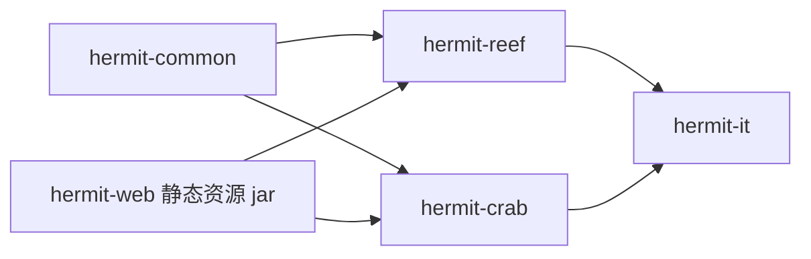
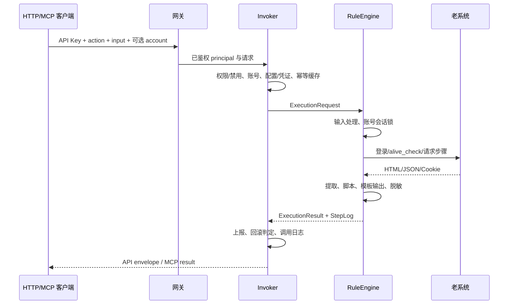

# 架构与代码地图

初次梳理基于 `0c1bbcf`，文档已同步到 `48daca7` 的部署与前端变更。缺陷见[审计报告](audits/2026-10-16.md)，支持范围见[功能状态](feature-status.md)。

## 概念与边界

| 概念 | 职责 |
| --- | --- |
| 规则包（Conch） | YAML 定义的一个系统及其 actions、认证步骤、凭证/配置声明和说明 |
| Action / capability | 业务能力；可投影为 HTTP API 和 MCP tool |
| Reef | 管理员登录、规则上传/校验/发布、签名、分发、统计与告警 |
| Crab | 内网执行器；本机保存账号/凭证/会话，执行 HTTP 步骤，提供网关 |
| Tide | Reef 中的上报、统计查询、告警子系统 |
| origin | 存储命名空间 `OFFICIAL`/`LOCAL`；产品调用链目前使用 `OFFICIAL` |

Reef 不代理老系统请求。Crab 主动拉取规则并上报，无需 Reef 入站连接 Crab。默认 Crab 只监听回环地址。

## 模块依赖

箭头表示被右侧依赖。Maven 顺序为 web → common → reef → crab → it。web 调用 npm，将两套 `dist` 放入 classpath 的 `hermit-web/`。Reef 是 Spring Boot 可执行 jar，Crab 是普通 jar。

## 源码地图

| 路径 | 核心职责/入口 |
| --- | --- |
| [common/model](../hermit-common/src/main/java/dev/hermit/common/model) | `ConchDoc`、`Action`、`Step`、深层不可变 `Frozen`、输出投影 `OutputShapes` |
| [common/parse](../hermit-common/src/main/java/dev/hermit/common/parse) / [validate](../hermit-common/src/main/java/dev/hermit/common/validate) | 形状/未知字段/别名解析，语义校验，`ConchDiff` |
| [common/template](../hermit-common/src/main/java/dev/hermit/common/template) / [pkg](../hermit-common/src/main/java/dev/hermit/common/pkg) | 表达式/过滤器，ZIP/SHA-256/Ed25519 |
| [reef](../hermit-reef/src/main/java/dev/hermit/reef) | `ReefApplication` 启动；`security` 三条安全链；`admin` 登录/初始化 |
| [reef/conch](../hermit-reef/src/main/java/dev/hermit/reef/conch) | 上传/发布/停用/回滚/分发，存储、数据库行锁和本地锁 |
| [reef/tide](../hermit-reef/src/main/java/dev/hermit/reef/tide) / [retention](../hermit-reef/src/main/java/dev/hermit/reef/retention) | 报告入库、聚合、告警/Webhook、过期清理 |
| [crab/cli](../hermit-crab/src/main/java/dev/hermit/crab/cli) | `CrabMain` 经 `CrabCommand` 分派命令 |
| [crab/runtime](../hermit-crab/src/main/java/dev/hermit/crab/runtime) | `CrabRuntime` 装配；`CrabServer` 生命周期；`Invoker` 调用层；`ConchAdmin` 管理操作 |
| [crab/engine](../hermit-crab/src/main/java/dev/hermit/crab/engine) | 输入校验、规则注册、账号锁/会话、步骤、Rhino 沙箱、输出脱敏 |
| [crab/store](../hermit-crab/src/main/java/dev/hermit/crab/store) / [secure](../hermit-crab/src/main/java/dev/hermit/crab/secure) | H2、账户、配置、凭证/会话/幂等响应加密、API Key、日志 |
| [crab/gateway](../hermit-crab/src/main/java/dev/hermit/crab/gateway) / [mcp](../hermit-crab/src/main/java/dev/hermit/crab/mcp) | HTTP API、本机控制台、OpenAPI、MCP HTTP/SSE、stdio 桥接 |
| [crab/sync](../hermit-crab/src/main/java/dev/hermit/crab/sync) / [report](../hermit-crab/src/main/java/dev/hermit/crab/report) | ETag/安装/回滚/版本保留；失败队列、小时计数与发送重试 |
| [web/apps](../hermit-web/apps) / [shared](../hermit-web/shared) | Vue 3 + TypeScript + Element Plus（按需引入）；两套路由/API 类型/共享组件、明暗主题 |
| [web/tests](../hermit-web/tests) | Vitest + jsdom；加载/空态、文案、主题、版本警告展示与图表刻度 |
| [Dockerfile.crab](../Dockerfile.crab) / [容器入口](../deploy/crab-entrypoint.sh) | 打包运行依赖、首次配置/公钥引导、主密钥/实例 ID 校验与降权启动 |

## 发布与同步

1. 管理员上传 YAML，经解析和校验后保存为 `UPLOADED`，同版本受唯一性约束。
2. `ConchPublishService` 锁定 Conch 记录，生成签名包、验签自检，标记 `PUBLISHED` 并切换当前版本。这里自检包完整性，不访问老系统。
3. Crab 用实例 UUID 和 Agent token 拉取带 ETag 的 manifest，下载 ZIP，检查签名、哈希、身份和最低版本后安装。
4. `ConchSync` 更新版本目录、`current`、数据库状态与注册表，清理被删除的凭证声明。可重试失败不记清单 ETag；304 时核对本地 current 与清单快照。已从 `local-conches/` 加载的本地包不会被这次同步下载、覆盖或卸下。
5. `RollbackGuard` 对同版本累计到 5 次 `RULE_MISMATCH` 且前一版本有成功记录时尝试回滚。成功调用清零，其他错误（含上游 HTTP 400 的 `INVALID_INPUT` 和会话失效的 `SESSION_EXPIRED`）不清零也不计数；不是所有请求严格相邻的“连续失败”。回滚写入 `current` 和固定记录后，控制台 `GET /console/api/sync` 在该 Conch 的文件锁内读取固定记录和 `current`（不替换注册表），把这一行显示为实际安装版本、`kind=ROLLED_BACK`、`reason=RULE_MISMATCH`，不再把坏版本显示成 `INSTALLED`。固定解除前都按这条投影。
6. 坏版本被固定后，相同或更低版本跳过，超过坏版本的新版本可解除固定。保留最近 3 版，并保护当前、前一和回滚相关版本。
7. Reef 连接失败（拒绝连接、无法解析、超时、同步被中断）时，这次尝试写入最近同步状态并清掉上次成功的 Conch 列表；手动 `POST /sync` 返回 502 `UPSTREAM_ERROR`，`message` 说明原因和下一步。下一次成功同步覆盖该失败。Reef 已经返回 HTTP 状态时不替换上次成功，手动请求仍是 500 `INTERNAL`。
8. 管理员停用 Conch 时，Reef 只写 `hermit_conch_availability`（Flyway V4）和审计，不改已签名的 ZIP。分发清单去掉该 Conch，ETag 随之变化。Crab 下次同步把已加载的 Conch 记入 `disabled_conches`（`CrabDatabase` 版本 7；版本 6 仍只是 `config_audit_at_idx`，已应用的版本 6 不改写），从注册表移除并删除 `current`，版本目录和账号凭证保留。新调用在进入引擎前返回 `CONCH_DISABLED`。重新启用后清单恢复原来的当前版本，Crab 重新验签安装并清掉停用记录。停用期间不能发布或回滚，上传仍可以。

注册表用不可变 Map 原子替换，但一次请求仍可能跨版本读取；见审计 A01。`Invoker` 把已经授权的 `ConchDoc` 交给引擎，执行使用这份快照，而不是中途再读注册表里的另一版本。停用先写墓碑再摘掉注册表项，不在这一步装上别的版本：新请求直接 `CONCH_DISABLED`，已经带着快照进来的请求仍执行那份快照。停用不再额外打开一个版本切换窗口。

## 一次调用

同一 `(origin, conch, account)` 由公平锁串行执行；不同账号可并行。执行能力前，没有会话或 alive_check 判定失效时会登录，不要求能力幂等。能力步骤执行中，重定向到登录页或上游返回 401/403 都视为会话失效：只有 `idempotent: true` 会重新登录并重放一次，其他返回 `SESSION_EXPIRED`；后续新请求仍可重新登录。上游 HTTP 400 是 `INVALID_INPUT`，不是 `RULE_MISMATCH`。HTTP 客户端禁用自动重试，同源检查防止请求/重定向把会话发到其他源。

## 页面路由

Reef 与 Crab 的浏览器页面都是同一份静态 `index.html`，不用请求路径去读别的文件。Reef 上凡是 GET、且不是 `/api/**`、`/agent/**`、`/assets/**` 的路径都返回这份文件；未登录不会因此得到 401 JSON，已有的前端路由再把未登录用户送进登录页。`GET /shells` 与 `GET /shells/**` 302 到 `/conches`。Crab 在回环连接上，`GET /console/**` 除 `/console/api/**` 和 `/console/assets/**` 外同样返回 `index.html`；`GET /console/shells` 与其子路径 302 到 `/console/conches`。这两处 302 的地址是固定的，不保留 shells 后面的名字。页面响应里没有账号、令牌或业务数据。`/api/**`、`/agent/**`、`/console/api/**` 的未知路径仍是 JSON 信封。页面加载后，前端把 `/shells` 与 `/shells/:conch` 转到 `/conches`；未知路径显示「页面不存在」（Reef 未登录仍先进入登录页）。

## 数据与信任

| 数据 | 位置与方式 |
| --- | --- |
| Reef 管理员、版本元数据、审计、报告、告警 | H2 或 MySQL。业务表、索引、唯一约束、检查约束和 Flyway 历史表 `hermit_flyway_schema_history` 都以 `hermit_` 开头。[Flyway SQL](../hermit-reef/src/main/resources/db/migration) 的 V1–V4 在发布前就地改写，没有数据迁移。已有 `reef-data` 里的 H2 和 Compose MySQL 库必须重建 |
| Reef YAML/包/签名密钥/JWT 密钥 | `data-dir/conches/`、`data-dir/keys/` |
| Crab 账号、配置、API Key、日志、队列、配置审计 | `HERMIT_HOME/data/crab.mv.db`；`CrabDatabase` 内置建表/迁移。`config_audit` 可按 conch/account 分页读取，响应不含凭证和配置值 |
| Crab 凭证、Cookie 会话、幂等响应 | H2 中 AES-256-GCM 密文；主密钥在环境变量或本机文件 |
| Crab 规则及当前版本 | `HERMIT_HOME/conches/<conch>/...` |
| API Key | 创建时返回一次明文；后续前缀和哈希查验 |
| 上报 | 错误类型/脱敏摘要、小时计数/延迟、回滚事件，不是完整请求响应 |

Reef 管理 JWT、Agent token、签名公钥是三个不同用途的信任边界。Crab 控制台依靠真实连接地址为回环地址且 API 带 `X-Hermit-Console: 1`，没有管理员登录，不能当成可公开反向代理的远程控制台。

## 生命周期与扩展

Crab 启动打开数据库/密钥，验证已安装规则，再监听 HTTP。首次同步后台执行，同步、上报、数据保留分别调度。`config.yml` 启动时读取；控制台写数据库的账号/配置/能力开关作用于后续请求。

新规则字段通常要同时修改模型、解析、校验、执行、HTTP/MCP 投影、前端类型与测试。Reef 持久化用新增 Flyway migration，Crab 用自身升级逻辑；上报协议修改要兼顾两端严格序列化与校验。表名前缀这次是发布前就地改写 V1–V4，之后的结构变化仍新增迁移。Crab 的 `CrabDatabase` 不使用 `hermit_` 前缀。
