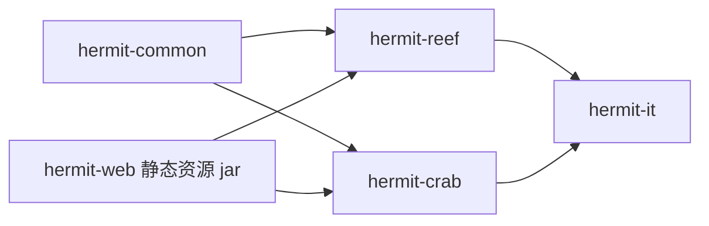
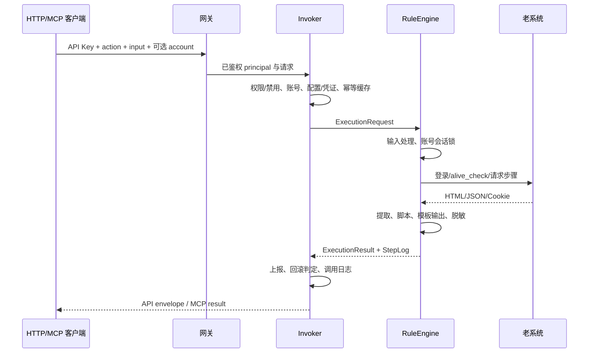

# 架构与代码地图

初次梳理基于 `0c1bbcf`，文档已同步到 `48daca7` 的部署与前端变更。缺陷见[审计报告](audits/2026-10-16.md)，支持范围见[功能状态](feature-status.md)。

## 概念与边界

| 概念 | 职责 |
| --- | --- |
| Shell | YAML 定义的一个系统及其 actions、认证步骤、凭证/配置声明和说明 |
| Action / capability | 业务能力；可投影为 HTTP API 和 MCP tool |
| Reef | 管理员登录、规则上传/校验/发布、签名、分发、统计与告警 |
| Crab | 内网执行器；本机保存账号/凭证/会话，执行 HTTP 步骤，提供网关 |
| Tide | Reef 中的上报、统计查询、告警子系统 |
| origin | 存储命名空间 `OFFICIAL`/`LOCAL`；产品调用链目前使用 `OFFICIAL` |

Reef 不代理老系统请求。Crab 主动拉取规则并上报，无需 Reef 入站连接 Crab。默认 Crab 只监听回环地址。

## 模块依赖

箭头表示被右侧依赖。Maven 顺序为 web → common → reef → crab → it。web 调用 npm，将两套 `dist` 放入 classpath 的 `hermit-web/`。Reef 是 Spring Boot 可执行 jar，Crab 是普通 jar。

## 源码地图

| 路径 | 核心职责/入口 |
| --- | --- |
| [common/model](../hermit-common/src/main/java/dev/hermit/common/model) | `ShellDoc`、`Action`、`Step`、深层不可变 `Frozen`、输出投影 `OutputShapes` |
| [common/parse](../hermit-common/src/main/java/dev/hermit/common/parse) / [validate](../hermit-common/src/main/java/dev/hermit/common/validate) | 形状/未知字段/别名解析，语义校验，`ShellDiff` |
| [common/template](../hermit-common/src/main/java/dev/hermit/common/template) / [pkg](../hermit-common/src/main/java/dev/hermit/common/pkg) | 表达式/过滤器，ZIP/SHA-256/Ed25519 |
| [reef](../hermit-reef/src/main/java/dev/hermit/reef) | `ReefApplication` 启动；`security` 三条安全链；`admin` 登录/初始化 |
| [reef/shell](../hermit-reef/src/main/java/dev/hermit/reef/shell) | 上传/发布/回滚/分发，存储、数据库行锁和本地锁 |
| [reef/tide](../hermit-reef/src/main/java/dev/hermit/reef/tide) / [retention](../hermit-reef/src/main/java/dev/hermit/reef/retention) | 报告入库、聚合、告警/Webhook、过期清理 |
| [crab/cli](../hermit-crab/src/main/java/dev/hermit/crab/cli) | `CrabMain` 经 `CrabCommand` 分派命令 |
| [crab/runtime](../hermit-crab/src/main/java/dev/hermit/crab/runtime) | `CrabRuntime` 装配；`CrabServer` 生命周期；`Invoker` 调用层；`ShellAdmin` 管理操作 |
| [crab/engine](../hermit-crab/src/main/java/dev/hermit/crab/engine) | 输入校验、规则注册、账号锁/会话、步骤、Rhino 沙箱、输出脱敏 |
| [crab/store](../hermit-crab/src/main/java/dev/hermit/crab/store) / [secure](../hermit-crab/src/main/java/dev/hermit/crab/secure) | H2、账户、配置、凭证/会话/幂等响应加密、API Key、日志 |
| [crab/gateway](../hermit-crab/src/main/java/dev/hermit/crab/gateway) / [mcp](../hermit-crab/src/main/java/dev/hermit/crab/mcp) | HTTP API、本机控制台、OpenAPI、MCP HTTP/SSE、stdio 桥接 |
| [crab/sync](../hermit-crab/src/main/java/dev/hermit/crab/sync) / [report](../hermit-crab/src/main/java/dev/hermit/crab/report) | ETag/安装/回滚/版本保留；失败队列、小时计数与发送重试 |
| [web/apps](../hermit-web/apps) / [shared](../hermit-web/shared) | Vue 3 + TypeScript + Element Plus；两套路由/API 类型/共享组件 |
| [web/tests](../hermit-web/tests) | Vitest + jsdom；加载/空态、文案、主题与版本警告展示 |
| [Dockerfile.crab](../Dockerfile.crab) / [容器入口](../deploy/crab-entrypoint.sh) | 打包运行依赖、首次配置/公钥引导、主密钥/实例 ID 校验与降权启动 |

## 发布与同步

1. 管理员上传 YAML，经解析和校验后保存为 `UPLOADED`，同版本受唯一性约束。
2. `ShellPublishService` 锁定 Shell 记录，生成签名包、验签自检，标记 `PUBLISHED` 并切换当前版本。这里自检包完整性，不访问老系统。
3. Crab 用实例 UUID 和 Agent token 拉取带 ETag 的 manifest，下载 ZIP，检查签名、哈希、身份和最低版本后安装。
4. `ShellSync` 更新版本目录、`current`、数据库状态与注册表，清理被删除的凭证声明。可重试失败不记清单 ETag；304 时核对本地 current 与清单快照。
5. `RollbackGuard` 对同版本累计到 5 次 `RULE_MISMATCH` 且前一版本有成功记录时尝试回滚。成功调用清零，其他错误不清零；不是所有请求严格相邻的“连续失败”。
6. 坏版本被固定后，相同或更低版本跳过，超过坏版本的新版本可解除固定。保留最近 3 版，并保护当前、前一和回滚相关版本。

注册表用不可变 Map 原子替换，但一次请求仍可能跨版本读取；见审计 A01。

## 一次调用

同一 `(origin, shell, account)` 由公平锁串行执行；不同账号可并行。会话失效时只有 `idempotent: true` 的能力会重新登录并重放一次，其他返回 `SESSION_EXPIRED`。HTTP 客户端禁用自动重试，同源检查防止请求/重定向把会话发到其他源。

## 数据与信任

| 数据 | 位置与方式 |
| --- | --- |
| Reef 管理员、版本元数据、审计、报告、告警 | H2 或 MySQL；[Flyway SQL](../hermit-reef/src/main/resources/db/migration) |
| Reef YAML/包/签名密钥/JWT 密钥 | `data-dir/shells/`、`data-dir/keys/` |
| Crab 账号、配置、API Key、日志、队列 | `HERMIT_HOME/data/crab.mv.db`；`CrabDatabase` 内置建表/迁移 |
| Crab 凭证、Cookie 会话、幂等响应 | H2 中 AES-256-GCM 密文；主密钥在环境变量或本机文件 |
| Crab 规则及当前版本 | `HERMIT_HOME/shells/<shell>/...` |
| API Key | 创建时返回一次明文；后续前缀和哈希查验 |
| 上报 | 错误类型/脱敏摘要、小时计数/延迟、回滚事件，不是完整请求响应 |

Reef 管理 JWT、Agent token、签名公钥是三个不同用途的信任边界。Crab 控制台依靠真实连接地址为回环地址且 API 带 `X-Hermit-Console: 1`，没有管理员登录，不能当成可公开反向代理的远程控制台。

## 生命周期与扩展

Crab 启动打开数据库/密钥，验证已安装规则，再监听 HTTP。首次同步后台执行，同步、上报、数据保留分别调度。`config.yml` 启动时读取；控制台写数据库的账号/配置/能力开关作用于后续请求。

新规则字段通常要同时修改模型、解析、校验、执行、HTTP/MCP 投影、前端类型与测试。Reef 持久化用新增 Flyway migration，Crab 用自身升级逻辑；上报协议修改要兼顾两端严格序列化与校验。
