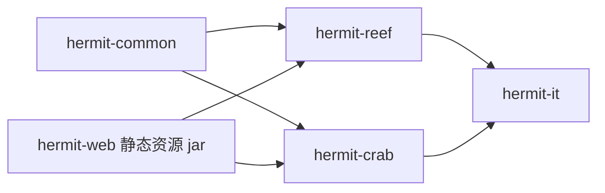
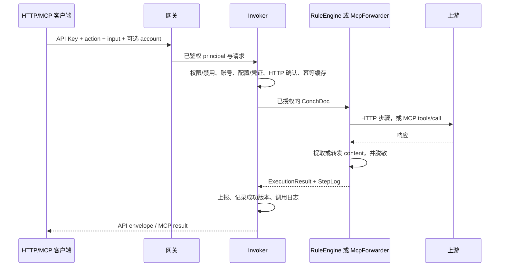

# 架构与代码地图

初次梳理基于 `0c1bbcf`，文档已同步到 `48daca7` 的部署与前端变更。缺陷见[审计报告](audits/2026-10-16.md)，支持范围见[功能状态](feature-status.md)。

## 概念与边界

| 概念 | 职责 |
| --- | --- |
| 规则包（Conch） | YAML 定义的一个系统及其 actions、认证步骤、凭证/配置声明和说明 |
| Action / capability | 业务能力；可投影为 HTTP API 和 MCP tool |
| Reef | 管理员登录、规则上传/校验/发布、签名、分发、统计与告警 |
| Crab | 内网执行器；本机保存账号/凭证/会话，执行 HTTP 步骤，提供网关 |
| Tide | Reef 中的上报、统计查询、告警子系统 |
| origin | 存储命名空间 `OFFICIAL`/`LOCAL`。正式包是 `OFFICIAL`，本机未签名包是 `LOCAL`。账号、凭证、配置和会话按这个来源隔离 |

Reef 不代理老系统请求。Crab 主动拉取规则并上报，无需 Reef 入站连接 Crab。默认 Crab 只监听回环地址。

## 模块依赖

箭头表示被右侧依赖。Maven 顺序为 web → common → reef → crab → it。web 调用 npm，将两套 `dist` 放入 classpath 的 `hermit-web/`。Reef 是 Spring Boot 可执行 jar，Crab 是普通 jar。

## 源码地图

| 路径 | 核心职责/入口 |
| --- | --- |
| [common/model](../hermit-common/src/main/java/dev/hermit/common/model) | `ConchDoc`、`Action`、`McpUpstream`、`McpTool`、`Step`、深层不可变 `Frozen`、输出投影 `OutputShapes` |
| [common/parse](../hermit-common/src/main/java/dev/hermit/common/parse) / [validate](../hermit-common/src/main/java/dev/hermit/common/validate) | 形状/未知字段/别名解析，语义校验，`ConchDiff`（含 MCP `toolChanges` 和脚本库名字差异） |
| [common/mcp](../hermit-common/src/main/java/dev/hermit/common/mcp) | `ToolSnapshots` 摘要、`McpAddresses` 主机字面量、`McpLimits` |
| [common/template](../hermit-common/src/main/java/dev/hermit/common/template) / [pkg](../hermit-common/src/main/java/dev/hermit/common/pkg) | 表达式/过滤器，ZIP/SHA-256/Ed25519 |
| [reef](../hermit-reef/src/main/java/dev/hermit/reef) | `ReefApplication` 启动；`security` 三条安全链；`admin` 登录/初始化 |
| [reef/conch](../hermit-reef/src/main/java/dev/hermit/reef/conch) | 上传/发布/停用/分发，存储、数据库行锁和本地锁 |
| [reef/tide](../hermit-reef/src/main/java/dev/hermit/reef/tide) / [retention](../hermit-reef/src/main/java/dev/hermit/reef/retention) | 报告入库、聚合、告警/Webhook、过期清理 |
| [crab/cli](../hermit-crab/src/main/java/dev/hermit/crab/cli) | `CrabMain` 经 `CrabCommand` 分派命令 |
| [crab/runtime](../hermit-crab/src/main/java/dev/hermit/crab/runtime) | `CrabRuntime` 装配；`CrabServer` 生命周期；`Invoker` 调用层；`ConchAdmin` 管理操作 |
| [crab/engine](../hermit-crab/src/main/java/dev/hermit/crab/engine) | 输入校验、规则注册、账号锁/会话、步骤、Rhino 沙箱、输出脱敏。`ConchExecutor` 由 `RuleEngine` 实现 |
| [crab/upstream](../hermit-crab/src/main/java/dev/hermit/crab/upstream) | `driver: mcp` 的 Streamable HTTP 转发。`headers` 用请求头模板；`oauth` 走 PKCE，令牌在凭证库，调用前刷新。本地刷新的 `tools/list` 走同一条令牌路径。OAuth 使用单独的 HTTP 客户端，不跟随重定向。账号锁只包住会话创建 |
| [crab/store](../hermit-crab/src/main/java/dev/hermit/crab/store) / [secure](../hermit-crab/src/main/java/dev/hermit/crab/secure) | H2、账户、配置、凭证/会话/幂等响应加密、API Key、日志 |
| [crab/gateway](../hermit-crab/src/main/java/dev/hermit/crab/gateway) / [mcp](../hermit-crab/src/main/java/dev/hermit/crab/mcp) | HTTP API、本机控制台、OpenAPI、MCP HTTP/SSE、stdio 桥接 |
| [crab/sync](../hermit-crab/src/main/java/dev/hermit/crab/sync) / [report](../hermit-crab/src/main/java/dev/hermit/crab/report) | ETag/安装/手动更新/版本保留；失败队列、小时计数与发送重试 |
| [web/apps](../hermit-web/apps) / [shared](../hermit-web/shared) | Vue 3 + TypeScript + Element Plus（按需引入）；两套路由/API 类型/共享组件、明暗主题 |
| [web/tests](../hermit-web/tests) | Vitest + jsdom；加载/空态、文案、主题、版本警告展示与图表刻度 |
| [Dockerfile.crab](../Dockerfile.crab) / [容器入口](../deploy/crab-entrypoint.sh) | 打包运行依赖、首次配置/公钥引导、主密钥/实例 ID 校验与降权启动 |

## 发布与同步

1. 管理员上传 YAML，经解析和校验后保存为 `UPLOADED`，同版本受唯一性约束。
2. `ConchPublishService` 锁定 Conch 记录。已有当前版本时，目标 semver 必须严格更高；否则 409，不切换。然后生成签名包、验签自检，标记 `PUBLISHED` 并切换当前版本。这里自检包完整性，不访问老系统。没有管理员回滚。`DELETE /api/admin/conches/{conch}/versions/{version}` 只删除 `UPLOADED`：先锁住该包的版本行，已发布则 409，不删签名 ZIP 和 YAML。成功后写审计 `DISCARD`，提交之后再删这个版本目录里的 YAML 和尚未发布时留下的 ZIP。
3. Crab 用实例 UUID 和 Agent token 拉取带 ETag 的 manifest。新装默认不订阅任何规则包。同步只下载并安装 `subscriptions` 里的名字；清单里其余条目记 `NOT_SUBSCRIBED`，不下载、不进注册表。已经从 `local-conches/` 加载的同名包记 `SKIPPED_LOCAL`，不下载、不覆盖。成功的 HTTP 200 把清单条目（含 title、description、capabilityCount；缺省时 title 为包名、description 为空、capabilityCount 为 0）写入目录缓存。Reef 清单另带 `driver` 和 `upstreamHost`（URL 主机，不含端口），ETag 覆盖它们，不连接上游。Crab 解析清单时忽略不认识的字段，目录缓存仍不存这两项。304 且本地快照仍匹配时沿用该缓存；缓存还没写过时再拉一次完整清单。
4. `ConchSync` 刷新目录。第一次订阅才下载并安装 Reef 当前版本。已经安装的正式包遇到更高清单版本记 `UPDATE_AVAILABLE`，不下载；更低版本记 `SKIPPED_OLDER`，不降级。已订阅、安装记录还在、但注册表没有这份包时，同步记 `REPAIR_REQUIRED` 且不下载。`REPAIR_REQUIRED` 可重试，不写入 ETag 快照，因此 304 不能盖住未加载；控制台读取仍会把这一行补到空的 304 上。显式更新先重新载入仍能验签的最新已安装 zip，`current` 停在该版本；验签失败才下载清单版本。注册表里仍有这份包时，手动更新才下载、验签，并在默认账号具备新增必填凭证后切换 `current` 和注册表。切换时才清理被删除的凭证声明。可重试失败不记清单 ETag。`UPDATE_AVAILABLE` 与 `SKIPPED_OLDER` 把已安装版本写入快照，因此后续同步可以 304。`NOT_SUBSCRIBED` 与 `SKIPPED_LOCAL` 都不阻止记下 ETag，也不写入 ETag 快照。`DISABLED` 也不阻止记下 ETag，并把本机保留的版本写入快照，因此 `current` 仍匹配时可以 304，且不会下载。订阅在写入订阅行之前会再拉一次清单，不看目录缓存；新鲜清单里没有这个名字且还没有订阅行则不插入并返回 404。已经订阅的名字再点一次仍清掉 ETag 再同步，避免 304 跳过安装。清单里已经没有、但本机已订阅且来源为 OFFICIAL 的已加载包写入 `disabled_conches`，注册表和 `current` 留在原地。未订阅的名字和 `Origin.LOCAL` 都留下，也不写墓碑。
5. `RULE_MISMATCH` 进入失败报告，不切换版本。成功的正式调用由 `Invoker` 写入 `version_success`。schema 12 删除 `pinned_rollbacks`。`mismatch_streak` 不再写入。
6. 保留最近 3 个安装过的版本，并保护当前版本、上一次成功的版本，以及这次切换之前的版本。失配不改变当前版本。
7. Reef 连接失败（拒绝连接、无法解析、超时、同步被中断）时，这次尝试写入最近同步状态并清掉上次成功的 Conch 列表；手动 `POST /sync` 返回 502 `UPSTREAM_ERROR`，`message` 说明原因和下一步。下一次成功同步覆盖该失败。Reef 已经返回 HTTP 状态，或清单读不出来时，不替换上次成功。手动请求仍是 500 `INTERNAL`，message 为「Reef 返回了 HTTP n。」或「Reef 返回的清单无法读取。」，不写 Reef 响应正文。
8. 管理员停用 Conch 时，Reef 只写 `hermit_conch_availability`（Flyway V4）和审计，不改已签名的 ZIP。分发清单去掉该 Conch，ETag 随之变化。Agent 清单没有停用标志，已停用、从未发布和已撤回的名字都不出现，Crab 读不到 `hermit_conch_availability`。契约是：本机注册表里已有、已订阅、来源是 OFFICIAL、并且这次从清单消失的包，下次同步写入 `disabled_conches`（`CrabDatabase` 版本 7；版本 6 仍只是 `config_audit_at_idx`，已应用的版本 6 不改写）。墓碑是标记。注册表项和 `current` 保留，版本目录和账号凭证保留，HTTP/MCP 仍经 `Invoker` 调用。同步在墓碑还在时不下载、不重试、不重装。第一次写入墓碑记一条 `REEF_CONCH_DISABLED`（actor `sync`，target `OFFICIAL/{conch}`，detail 为包名）。清单再次列出该名字时清掉墓碑，记一条 `REEF_CONCH_ENABLED`，然后按普通更新继续（相同版本不下载，更高版本记 `UPDATE_AVAILABLE`，更低版本记 `SKIPPED_OLDER`）。停用和撤回在清单上相同；已经装在本机的包都按停用保留。从未装进注册表的名字不写墓碑。停用期间 Reef 不能发布，上传仍可以。本机退订则删掉 `subscriptions` 行、卸下注册表、清掉 `current`，并清掉已有停用墓碑，不新写墓碑，也不写 `REEF_CONCH_ENABLED`；账号、凭证和配置保留。已经拿着授权快照的请求仍执行那份快照。schema 8 升级时，已有 `current` 指针的合法包名会以 actor `migration` 写入订阅，避免升级后不再更新。只有墓碑还在、注册表里已经没有这份包时，新调用才返回 409 `CONCH_DISABLED`，message 为「Reef 已停用该规则包，本机没有可调用的副本。」。手动更新在墓碑还在时不下载：本机仍加载时 message 为「Reef 已停用该规则包，不再下载。」，本机文件已经丢失时与调用同一句。本机关掉的能力是 404 `CAPABILITY_DISABLED`，能力不存在仍是 `NOT_FOUND`。

注册表用不可变 Map 原子替换，但一次请求仍可能跨版本读取；见审计 A01。`Invoker` 把已经授权的 `ConchDoc` 交给引擎，执行使用这份快照，而不是中途再读注册表里的另一版本。Reef 停用只写墓碑，不替换注册表里的版本：已加载的调用继续走权限和能力检查，已经带着快照进来的请求仍执行那份快照。停用不打开版本切换窗口。

## 一次调用

HTTP 包的同一 `(origin, conch, account)` 由公平锁串行执行；不同账号可并行。规则包写了 `auth.concurrent_reads: true` 时，`mcp.read_only` 的能力在会话可直接使用时拿这把锁的读锁，彼此并行；登录、探活、会话失效后的处理和其它能力仍拿写锁。mcp 包只在创建或替换上游会话时拿这把锁，`tools/call` 的并发由 `engine.mcp_max_concurrency_per_account` 限制。执行 HTTP 能力前，没有会话或 alive_check 判定失效时会登录，不要求能力幂等。能力步骤执行中，重定向到登录页或上游返回 401/403 都视为会话失效：只有 `idempotent: true` 会重新登录并重放一次，其他返回 `SESSION_EXPIRED`；后续新请求仍可重新登录。上游 HTTP 400 是 `INVALID_INPUT`，不是 `RULE_MISMATCH`。500 及以上是 `UPSTREAM_ERROR`。其它非 2xx 在后续 `assert.status` 覆盖实际状态码时放行；非 GET 的 3xx 且不是登录重定向也放行。没有这种期望的 GET 404 等在提取前是 `UPSTREAM_ERROR`，message 带状态码。未写 `timeout_ms` 的空闲读停在能力 deadline，到点是 `TIMEOUT`；步骤自己的 `timeout_ms` 更短时是 `UPSTREAM_ERROR`「步骤超时」。规则引擎和 MCP 转发只在 GET、HEAD、OPTIONS 复用已经完成过请求的连接，并且第一次遇到对端没有响应或连接被重置时，换一条连接再试一次；新连接上的失败不重试。POST 和其他方法不重试，503 和超时也不重试。OAuth 的发现和令牌请求不重试。同源检查防止请求/重定向把会话发到其他源。mcp 转发不跟随重定向，不把客户端的 API Key 或 `Mcp-Session-Id` 交给上游。开发者模式打开时，本地 MCP 的 JSON-RPC 与 HTTP 步骤共用 `dev_traces`；刷新把过滤后的工具写回 `local-conches/{conch}.yaml`，不改版本，也不写调用记录。

不同规则包之间不共用会话。两个包访问同一网站（生效 `base_url` 的协议、主机、端口相同，`SiteAddress`）时，`CrabRuntime.sites()` 把它们标出来给控制台；`RuleEngine` 在登录成功和能力请求发现会话失效时通知 `SessionContention`，10 分钟内两个包轮流被对方的登录顶掉满 3 轮就在内存里记一条告警。这只是提示：不改调用结果，不共用 Cookie。`Invoker` 在 `SESSION_EXPIRED` 的说明后面加一句，只对能调用对方的 API Key 写出包名。

## 页面路由

Reef 与 Crab 的浏览器页面都是同一份静态 `index.html`，不用请求路径去读别的文件。Reef 上凡是 GET、且不是 `/api/**`、`/agent/**`、`/assets/**` 的路径都返回这份文件；未登录不会因此得到 401 JSON，已有的前端路由再把未登录用户送进登录页。`GET /shells` 与 `GET /shells/**` 302 到 `/conches`。Crab 在回环连接上，`GET /console/**` 除 `/console/api/**` 和 `/console/assets/**` 外同样返回 `index.html`；`GET /console/shells` 与其子路径 302 到 `/console/conches`。这两处 302 的地址是固定的，不保留 shells 后面的名字。页面响应里没有账号、令牌或业务数据。`/api/**`、`/agent/**`、`/console/api/**` 的未知路径仍是 JSON 信封。页面加载后，前端把 `/shells` 与 `/shells/:conch` 转到 `/conches`；未知路径显示「页面不存在」（Reef 未登录仍先进入登录页）。

## 数据与信任

| 数据 | 位置与方式 |
| --- | --- |
| Reef 管理员、版本元数据、审计、报告、告警、Agent 令牌 | H2 或 MySQL。业务表、索引、唯一约束、检查约束和 Flyway 历史表 `hermit_flyway_schema_history` 都以 `hermit_` 开头。[Flyway SQL](../hermit-reef/src/main/resources/db/migration) 的 V1–V4 在发布前就地改写，没有数据迁移。已有 `reef-data` 里的 H2 和 Compose MySQL 库必须重建。V5 增加 `pull_count`，V6 增加角色、令牌哈希和 Crab 实例，V7 增加 `hermit_voided_config_tokens`，V8 增加管理员的 `token_version`（改口令或重置口令后作废已签出的 JWT）。这几次是新增迁移，升级不必重建库。生产执行过 V1–V7（V1 含登录失败表主键），之后只新增迁移，`MigrationHistoryTest` 钉住已合入迁移的哈希 |
| Reef YAML/包/签名密钥/JWT 密钥 | `data-dir/conches/`、`data-dir/keys/` |
| Crab 账号、配置、API Key、日志、队列、配置审计、控制台口令哈希 | `HERMIT_HOME/data/crab.mv.db`；`CrabDatabase` 内置建表/迁移。`config_audit` 可按 conch/account 分页读取，响应不含凭证和配置值。控制台口令只存 schema 14 的 PBKDF2 哈希，不进 `config.yml`。schema 15 的 `dev_traces` 是本地 HTTP 与本地 MCP 调试用的脱敏 JSON，同一条追踪可以累加多轮 JSON-RPC，不进 `config.yml`；关掉开发者模式或开关到期时整表删除。schema 16 的 `session_login` 按 `(origin, conch, account)` 存登录快照密文，AAD 字段是 `login`，升级不回填 |
| Crab 凭证、Cookie 会话、幂等响应 | H2 中 AES-256-GCM 密文；主密钥在环境变量或本机文件 |
| Crab 规则及当前版本 | `HERMIT_HOME/conches/<conch>/...` |
| API Key | 创建时返回一次明文；后续前缀和哈希查验 |
| 上报 | 错误类型/脱敏摘要、小时计数/延迟、回滚事件，不是完整请求响应 |

Reef 管理 JWT、Agent 令牌（每用户哈希，外加可选的配置令牌）和签名公钥是不同用途的信任边界。Crab 在 Reef 上的身份是用户加上实例 UUID。Crab 控制台依靠真实连接地址为回环地址、`Host`/`Origin` 为回环名字（防 DNS rebinding），且 API 带 `X-Hermit-Console: 1`。口令未设置时没有登录。设置之后 `/console/api/**` 还要会话 Cookie `hermit_console`，只有口令、没有用户名。页面和静态资源仍不认这张 Cookie。不能当成可公开反向代理的远程控制台。

## 生命周期与扩展

Crab 启动打开数据库/密钥，验证已安装规则，再监听 HTTP。首次同步后台执行，同步、上报、数据保留分别调度。`config.yml` 启动时读取；控制台写数据库的账号/配置/能力开关作用于后续请求。

新规则字段通常要同时修改模型、解析、校验、执行、HTTP/MCP 投影、前端类型与测试。Reef 持久化用新增 Flyway migration，Crab 用自身升级逻辑；上报协议修改要兼顾两端严格序列化与校验。表名前缀是发布前就地改写的 V1–V4；投产之后 Reef 迁移和 Crab 升级步骤都只新增版本，不改已发布的版本。Crab 的 `CrabDatabase` 不使用 `hermit_` 前缀。
